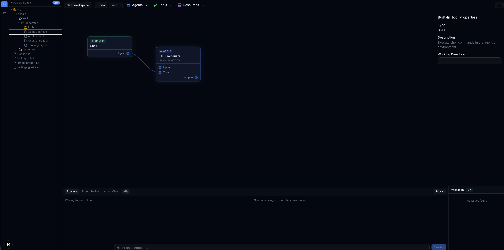

<div align="center">

# 🧩 Koog Agent Modeler

**AI-Agenten visuell modellieren – als lauffähigen Kotlin-Code exportieren.**




</div>

Agenten, Tools, Sub-Agents und MCP-Server per Drag & Drop auf den Canvas ziehen, verbinden, validieren – und mit einem Klick ein kompilierbares [JetBrains Koog](https://github.com/JetBrains/koog)-Projekt erhalten. Kein Boilerplate.

## ✅ MVP

> **Ziel:** Ein Agent mit mehreren Tools – modelliert und als lauffähiger Kotlin-Code exportiert in **unter 5 Minuten**.

| | Feature | Beschreibung |
|---|---|---|
| 🎨 | **Canvas Engine** | Node-/Edge-Editor auf Basis von Rete.js |
| 🤖 | **Agent-Node** | Name, System-Prompt, Modell, Temperatur |
| 🛠️ | **Tool-Node** | Eigene Tools mit Parametern + Builtins (Shell, Filesystem, Fetch, …) |
| 🔌 | **Input / Output** | Grundmodell für Ein- und Ausgaben des Agenten |
| 🧠 | **LLM-Provider** | OpenAI, Anthropic, Google, Bedrock, Ollama |
| 🔍 | **Validierung** | Fehler pro Node, live im Editor und serverseitig |
| 💾 | **JSON-Persistenz** | Projekte speichern, laden, importieren |
| 📦 | **Kotlin-Export** | ZIP mit `build.gradle.kts`, Agent, ToolRegistry, Dockerfile |

**Workflow:** Agent anlegen → Tools verbinden → validieren → exportieren.

## 🚀 Darüber hinaus

- **Live Code Explorer** – generierter Code in Echtzeit neben dem Graphen
- **Agent Preview** – Agent direkt in der App chatten, mit Execution-Timeline
- **LLM Code Review** – Review des Exports nach Critical / Warning / Suggestion
- **Erweiterte Nodes** – Sub-Agent, Planner, RAG, Graph-Agent, A2A, MCP-Server
- **Export-Ziele** – Spring Boot oder Ktor / Wasm

## ⚡ Quickstart

```bash
./gradlew bootRun                 # Backend  → :8080
cd frontend && npm run dev        # Frontend → :3000
```

Für Preview & Review wird `OPENAI_API_KEY` benötigt – exportierte Agenten laufen mit **Ollama** auch lokal ohne Key.
Beispielprojekte zum Importieren: [`docs/examples/`](docs/examples/).

## 🏗️ Architektur

```
Editor-Graph ─▶ GraphToKoogAdapter ─▶ KoogModel ─▶ KotlinPoet-Generatoren ─▶ ZIP / VFS
```

| Schicht | Stack |
|---|---|
| Frontend | Next.js 16, React 19, Rete.js, Zustand, Tailwind, Monaco |
| Backend | Kotlin, Spring Boot 4, Koog 1.3.0, KotlinPoet, JimFS |

## 📄 Lizenz

[Apache License 2.0](LICENSE)
